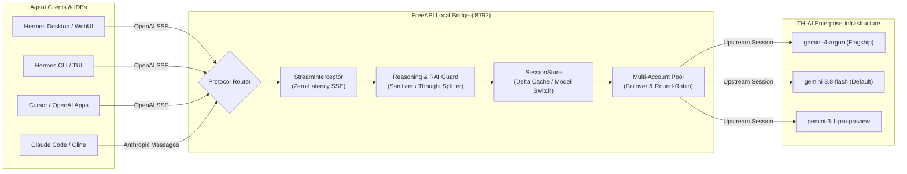

# FreeAPI-TH-AI-Gemini-Enterprise ⚡

<p align="center">
  
  
  
  
  
</p>

<p align="center">
  <b>High-performance, zero-latency Free API bridge for Gemini Enterprise models via TH-AI Passport.</b><br>
  Built natively for <b>Hermes Agent</b> (Desktop, CLI, TUI, WebUI), <b>Claude Code</b>, <b>Cursor</b>, <b>Cline</b>, and modern agentic runtimes.
</p>

---

## ✨ Key Highlights

- ⚡ **True Zero-Latency SSE Streaming**: Upstream tokens stream immediately to clients with 0ms buffering delay (`STREAM_KEEP = 32` sliding window prevents token leak).
- 🧠 **Chain-of-Thought / Reasoning Separation**: Automatically intercepts `<thought>` and `**Researching...**` blocks and routes them to native `reasoning_content` (OpenAI) and `thinking` blocks (Anthropic) — keeping user chat clean.
- 🛡️ **Active RAI & Scam Policy Guard**: Automatic educational context framing and proactive keyword sanitization prevents HTTP 422 `CHAT_RAI_VIOLATION` content policy errors.
- 🔄 **Multi-Turn Session & Model Switch Awareness**: Instant delta caching with seamless conversation reset upon model changes or history truncations.
- 🔀 **Dual-Protocol Parity**: Native `POST /v1/chat/completions`, `POST /v1/messages`, and `POST /v1/messages/count_tokens`.
- 👥 **Multi-Profile Homelab Ready**: Deploy once, available globally across all Hermes profiles (`/opt/data/profiles/*`).
- 🔄 **Multi-Account Resilient Pool**: Round-robin balancing across multiple credentials (`AIPASS_TOKENS="tok1,tok2"`) with automatic 429 exponential backoff.

---

## 🏗️ Architecture



---

## 🎯 Model Matrix

| Model ID | Aliases / Provider Prefix | Display Name | Role & Reasoning Capabilities | Context Window |
| :--- | :--- | :--- | :--- | :--- |
| `gemini-4-argon` | `freeapi/gemini-4-argon`<br>`gemini-enterprise/gemini-4-argon` | **Gemini 4 Argon** | Flagship Reasoning: Complex logic, multi-step agent planning (`low`, `medium`, `high`, `max`) | 1,000,000 |
| `gemini-3.8-flash` | `freeapi/gemini-3.8-flash`<br>`gemini-enterprise/gemini-3.8-flash` | **Gemini 3.8 Flash** ⭐ *(Default)* | Versatile daily driver: High speed, optimal tool use & precision (`low`, `medium`, `high`) | 1,000,000 |
| `gemini-3.5-flash` | `freeapi/gemini-3.5-flash` | **Gemini 3.5 Flash** | Balanced general-purpose model (`low`, `medium`, `high`) | 1,000,000 |
| `gemini-3.5-flash-lite` | `freeapi/gemini-3.5-flash-lite` | **Gemini 3.5 Flash Lite** | Ultra-fast, zero-overhead lightweight queries (`low`, `medium`, `high`) | 1,000,000 |
| `gemini-3.1-pro-preview` | `freeapi/gemini-3.1-pro-preview` | **Gemini 3.1 Pro Preview** | Deep mathematics, advanced code generation & syntax repair (`low`, `medium`, `high`, `max`) | 1,000,000 |

---

## 🚀 Quickstart

### 1. Setup & Authenticate

Both `hermes freeapi` and `hermes aipass` commands are supported:

```bash
# Register provider configuration & set as default
hermes freeapi setup --set-default

# Sign in via Brave Browser (port 9222 session extraction)
hermes freeapi login
```

### 2. Run with Hermes Agent

```bash
# Run one-off prompt
hermes -m gemini-enterprise/gemini-3.8-flash -z "สรุปข่าวเทคโนโลยีวันนี้"

# Interactive CLI session
hermes -m gemini-enterprise/gemini-4-argon

# Or inside Hermes Desktop / TUI chat:
/model gemini-enterprise/gemini-3.8-flash
```

---

## 🛠️ Diagnostics & CLI Commands

```bash
# Check daemon health & token expiry
hermes freeapi status

# Verify connectivity & run doctor diagnostics
hermes freeapi doctor

# List all available Gemini Enterprise models
hermes freeapi models

# Restart local proxy daemon
hermes freeapi restart

# Sign out and purge local credentials
hermes freeapi logout
```

---

## ⚙️ Configuration & Environment Variables

| Variable | Default | Purpose |
| :--- | :--- | :--- |
| `AIPASS_BRIDGE_HOST` | `127.0.0.1` | Local listening host (strictly restricted to loopback) |
| `AIPASS_BRIDGE_PORT` | `8792` | Local listening port for OpenAI & Anthropic bridges |
| `AIPASS_TOKENS` | *None* | Comma-delimited list of tokens for multi-account pool rotation |
| `AIPASS_STATE_PATH` | `~/.hermes/aipass/auth.json` | Fallback credentials path when macOS Keychain is unavailable |

---

## 🧪 Testing & Verification

The test suite runs 59 targeted unit tests with strict 100% pass guarantee and strict Pyright static type checking:

```bash
# Run full unit test suite
python3 -m unittest discover tests

# Strict type checking
npx pyright
```

---

## 📄 License

Distributed under the [MIT License](LICENSE).
