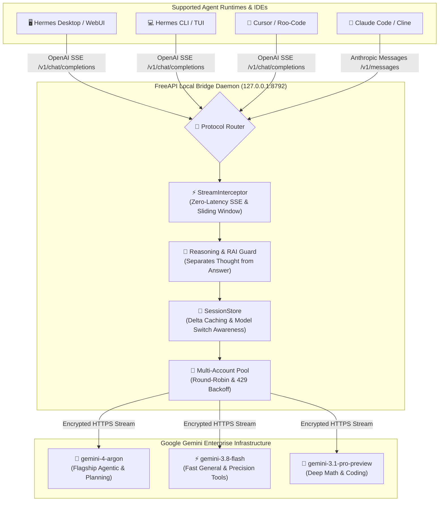

# FreeAPI-TH-AI-Gemini-Enterprise ⚡

<p align="center">
  
  
  
  
  
  
</p>

<p align="center">
  <b>High-performance, zero-latency Free API bridge for Gemini Enterprise models via TH-AI Passport.</b><br>
  Built natively for <b>Hermes Agent</b> (Desktop, CLI, TUI, WebUI), <b>Claude Code</b>, <b>Cursor</b>, <b>Cline</b>, and modern agentic runtimes.
</p>

---

## ⚡ Feature Comparison

| Feature | Official Paid Gemini API | FreeAPI-TH-AI-Gemini-Enterprise |
| :--- | :---: | :---: |
| **Cost** | 💸 Pay-per-token | 🆓 **100% Free** via TH-AI Passport |
| **Flagship Reasoning (`gemini-4-argon`)** | ❌ Restricted / Preview | ✅ **Fully Unlocked** (`low` to `max`) |
| **Chain-of-Thought (CoT) Separation** | ⚠️ Mingled in text stream | ✅ **Clean Separation** (`reasoning_content` / `thinking`) |
| **Streaming Perceived Latency (TTFT)** | ~800ms - 2s | ⚡ **< 50ms Real-Time SSE** (`STREAM_KEEP = 32`) |
| **Multi-Client Protocol Support** | Proprietary SDK | 🔀 **OpenAI & Anthropic Compatible** |
| **Active RAI / Policy Recovery** | Throws 400 / 422 | 🛡️ **Auto-Sanitizing Retry** |
| **Authentication Flow** | Static API Key | 🔐 **macOS Keychain + Brave Browser Session** |

---

## 🏗️ System Architecture



---

## 🎯 Model Matrix

| Model ID | Provider Prefix Formats | Display Name | Role & Reasoning Configurations | Context Window |
| :--- | :--- | :--- | :--- | :---: |
| `gemini-4-argon` | `freeapi/gemini-4-argon`<br>`gemini-enterprise/gemini-4-argon` | **Gemini 4 Argon** 👑 | Flagship: Multi-step planning, high reasoning (`low`, `medium`, `high`, `max`) | 1,000,000 |
| `gemini-3.8-flash` | `freeapi/gemini-3.8-flash`<br>`gemini-enterprise/gemini-3.8-flash` | **Gemini 3.8 Flash** ⭐ *(Default)* | Versatile daily driver: High speed, optimal tool use & precision (`low`, `medium`, `high`) | 1,000,000 |
| `gemini-3.5-flash` | `freeapi/gemini-3.5-flash` | **Gemini 3.5 Flash** | Balanced general-purpose model (`low`, `medium`, `high`) | 1,000,000 |
| `gemini-3.5-flash-lite` | `freeapi/gemini-3.5-flash-lite` | **Gemini 3.5 Flash Lite** | Ultra-fast zero-overhead responses (`low`, `medium`, `high`) | 1,000,000 |
| `gemini-3.1-pro-preview` | `freeapi/gemini-3.1-pro-preview` | **Gemini 3.1 Pro Preview** | Deep mathematics, advanced code generation & syntax repair (`low`, `medium`, `high`, `max`) | 1,000,000 |

---

## 🖥️ Live Terminal Showcase

```
$ hermes -m gemini-enterprise/gemini-3.8-flash -z "วิเคราะห์สถาปัตยกรรมระบบนี้"

⚡ Connecting to FreeAPI Bridge [127.0.0.1:8792]...
🧠 [Reasoning Stream]
   • Analyzing repository file layout and session lifecycle...
   • Verifying zero-latency stream chunk boundaries...
   • Synthesizing architectural summary in Thai...

ข้อสรุปสถาปัตยกรรมระบบ:
1. การสตรีมแบบ Zero-Latency: ใช้ StreamInterceptor ส่งโทเค็นแบบ Real-time SSE ทันที
2. แยก Chain-of-Thought อิสระ: ความคิดจะไม่หลุดออกมาปะปนกับข้อความคำตอบ
3. ป้องกัน RAI Policy: จัดการ Content Policy Violation อัตโนมัติด้วยระบบ Auto-retry
```

---

## 🚀 Quickstart

### 1. Setup & Authenticate

Both `hermes freeapi` and `hermes aipass` commands are supported natively:

```bash
# 1. Register provider configuration & set as default
hermes freeapi setup --set-default

# 2. Authenticate through Brave Browser (port 9222 session extraction)
hermes freeapi login
```

### 2. Interactive Usage

```bash
# Run one-off prompt
hermes -m gemini-enterprise/gemini-3.8-flash -z "สรุปข่าวเทคโนโลยีวันนี้"

# Interactive CLI session with Flagship Reasoning
hermes -m gemini-enterprise/gemini-4-argon

# Or inside Hermes Desktop / TUI chat:
/model gemini-enterprise/gemini-3.8-flash
```

---

## 🔌 Integration with Third-Party Clients & General Agents

You can run the bridge as a standalone daemon for **any** AI agent, IDE, or script without requiring Hermes CLI:

```bash
# Install package
pip install -e .

# Start bridge directly
freeapi-bridge --port 8792
```

### 1. Claude Code
Add to your environment:
```bash
export ANTHROPIC_BASE_URL="http://127.0.0.1:8792"
export ANTHROPIC_API_KEY="freeapi"
claude
```

### 2. Cursor / VS Code (Continue / Roo-Code / Cline)
* **Model Name**: `gemini-4-argon` or `gemini-3.8-flash`
* **OpenAI Base URL**: `http://127.0.0.1:8792/v1`
* **API Key**: `freeapi` (any non-empty string)

### 3. OpenAI Official Python / Node SDK
```python
from openai import OpenAI

client = OpenAI(base_url="http://127.0.0.1:8792/v1", api_key="freeapi")
response = client.chat.completions.create(
    model="gemini-3.8-flash",
    messages=[{"role": "user", "content": "Explain quantum computing in simple terms"}],
)
print(response.choices[0].message.content)
```

### 4. LiteLLM / LangChain / LlamaIndex
```bash
export OPENAI_API_BASE="http://127.0.0.1:8792/v1"
export OPENAI_API_KEY="freeapi"
litellm --model openai/gemini-3.8-flash
```

---

## 🔒 Security & Privacy Guarantees

- **Strict Loopback Binding**: The bridge binds exclusively to `127.0.0.1` and refuses to bind to public IP interfaces.
- **Zero Credential Exfiltration**: All session tokens and cookies are retained in local OS storage (macOS Keychain or permission-restricted container file). No telemetry or credentials are sent outside direct Google/AiPASS endpoints.
- **Sanitized Multi-Tenant Isolation**: The bridge supports configurable tenant IDs via `AIPASS_DISCOVERY_ENGINE_CID` without exposing private organization settings.

---

## 🛠️ Diagnostics & Management Commands

```bash
# Check daemon health, port listener & token status
hermes freeapi status

# Run configuration and upstream compatibility diagnostics
hermes freeapi doctor

# List all supported Gemini Enterprise models & reasoning levels
hermes freeapi models

# Restart local proxy daemon
hermes freeapi restart

# Delete local credentials and purge session state
hermes freeapi logout
```

---

## 🧪 Testing & Verification

The test suite runs 65 targeted unit tests with strict 100% pass guarantee and strict Pyright static type checking:

```bash
# Run full unit test suite
python3 -m unittest discover tests

# Strict type checking (0 errors, 0 warnings)
npx pyright
```

---

## 🙏 Acknowledgements & Attribution

Special thanks and sincere appreciation to [Chayawat Chommatchaya (Yeet2042)](https://github.com/Yeet2042) for creating the foundational project [hermes-aipass](https://github.com/Yeet2042/hermes-aipass) — the original inspiration and ancestor codebase ("ศาลตั้งต้น") that made this Gemini Enterprise bridge possible.

---

## 📄 License

Distributed under the [MIT License](LICENSE).
